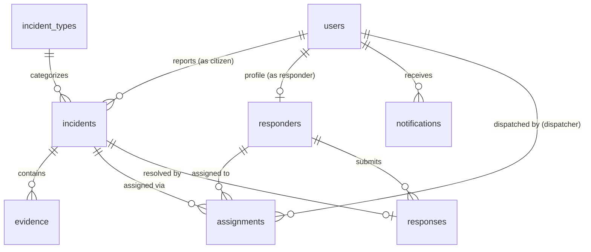

# Implementation Plan: SpectraRescue — Paranormal Emergency Dispatch and Response System

SpectraRescue is a Laravel + MySQL web application built with a beginner-friendly MVC structure for a student final project and school defense. It enables citizens to report paranormal emergencies, dispatchers to assess and assign responders, verified responders (exorcists, ghost hunters) to accept assignments and file resolution reports, and administrators to oversee users, verify responders, and view reports.

## User Review Required

> [!IMPORTANT]
> **Database & Environment Notice:**
> The `.env` file is currently configured for MySQL (`projectalien2026` on `127.0.0.1:3306`, user `root`, no password). When we execute migrations, Laravel will automatically prompt to create the `projectalien2026` database in your local WampServer MySQL server.

> [!NOTE]
> **Authentication & Authorization Design:**
> Per the student-friendly coding instructions, we will implement standard Laravel session-based authentication with simple role checks (`role` column on the `users` table: `'citizen'`, `'dispatcher'`, `'responder'`, `'admin'`) and a clean `RoleMiddleware`. This is simple, robust, and 100% explainable during your defense without complicated packages.

---

## Proposed Database Architecture

### Table Details

1. **`users`**:
   - `id`, `name`, `email`, `password`, `phone`, `role` (`'citizen'`, `'dispatcher'`, `'responder'`, `'admin'`), `timestamps`
2. **`incident_types`**:
   - `id`, `name` (e.g., Haunting, Demonic Possession, Cursed Relic, Apparition Attack), `description`, `default_threat_level`, `timestamps`
3. **`responders`**:
   - `id`, `user_id` (foreign key to `users`), `specialization` (e.g. Exorcist, Ghost Hunter, Medium), `badge_number`, `bio`, `verification_status` (`'pending'`, `'approved'`, `'rejected'`), `is_available` (boolean), `timestamps`
4. **`incidents`**:
   - `id`, `citizen_id` (foreign key to `users`), `incident_type_id` (foreign key to `incident_types`), `title`, `description`, `location_address`, `location_city`, `threat_level` (`'Low'`, `'Medium'`, `'High'`, `'Critical'`), `status` (`'Pending'`, `'Dispatched'`, `'Responding'`, `'Resolved'`, `'Cancelled'`), `timestamps`
5. **`evidence`**:
   - `id`, `incident_id` (foreign key to `incidents`), `file_path`, `file_type`, `caption`, `timestamps`
6. **`assignments`**:
   - `id`, `incident_id` (foreign key to `incidents`), `responder_id` (foreign key to `responders`), `dispatcher_id` (foreign key to `users`), `status` (`'assigned'`, `'accepted'`, `'declined'`), `dispatcher_notes`, `assigned_at`, `responded_at`, `timestamps`
7. **`responses`**:
   - `id`, `incident_id` (foreign key to `incidents`), `responder_id` (foreign key to `responders`), `containment_method`, `findings_summary`, `threat_neutralized` (boolean), `evidence_collected`, `submitted_at`, `timestamps`
8. **`notifications`**:
   - `id`, `user_id` (foreign key to `users`), `title`, `message`, `link`, `is_read` (boolean), `timestamps`

---

## Proposed Changes

### 1. Database Migrations & Seeders
Create simple, clear migrations in [database/migrations/](file:///j:/SystemFilesNew/wamp64/www/ProjectALIEN2026/database/migrations/):
* **[NEW]** `create_incident_types_table.php`
* **[NEW]** `create_responders_table.php`
* **[NEW]** `create_incidents_table.php`
* **[NEW]** `create_evidence_table.php`
* **[NEW]** `create_assignments_table.php`
* **[NEW]** `create_responses_table.php`
* **[NEW]** `create_notifications_table.php`
* **[MODIFY]** `0001_01_01_000000_create_users_table.php` (add `role` and `phone`)
* **[NEW]** [database/seeders/DatabaseSeeder.php](file:///j:/SystemFilesNew/wamp64/www/ProjectALIEN2026/database/seeders/DatabaseSeeder.php) (pre-populates demo accounts for all 4 roles + sample incidents for easy live defense demonstration)

---

### 2. Models & Eloquent Relationships
Create straightforward models in [app/Models/](file:///j:/SystemFilesNew/wamp64/www/ProjectALIEN2026/app/Models/):
* **[MODIFY]** [User.php](file:///j:/SystemFilesNew/wamp64/www/ProjectALIEN2026/app/Models/User.php) — helper methods: `isCitizen()`, `isDispatcher()`, `isResponder()`, `isAdmin()`, relationships to `incidents`, `responderProfile`, `notifications`.
* **[NEW]** `IncidentType.php` — `hasMany` incidents.
* **[NEW]** `Responder.php` — `belongsTo` User, `hasMany` assignments, `hasMany` responses.
* **[NEW]** `Incident.php` — `belongsTo` User (citizen), `belongsTo` IncidentType, `hasMany` evidence, `hasMany` assignments, `hasOne` latestAssignment, `hasOne` responseReport.
* **[NEW]** `Evidence.php` — `belongsTo` Incident.
* **[NEW]** `Assignment.php` — `belongsTo` Incident, `belongsTo` Responder, `belongsTo` User (dispatcher).
* **[NEW]** `Response.php` — `belongsTo` Incident, `belongsTo` Responder.
* **[NEW]** `Notification.php` — `belongsTo` User.

---

### 3. Middleware & Routing
* **[NEW]** `app/Http/Middleware/RoleMiddleware.php` — simple check: ensures `Auth::check()` and matches required role(s).
* **[MODIFY]** [bootstrap/app.php](file:///j:/SystemFilesNew/wamp64/www/ProjectALIEN2026/bootstrap/app.php) — register `role` middleware alias.
* **[MODIFY]** [routes/web.php](file:///j:/SystemFilesNew/wamp64/www/ProjectALIEN2026/routes/web.php) — cleanly grouped routes by role:
  - Guest routes: landing page, login, register citizen, register responder.
  - Auth routes: logout, profile, notifications.
  - Citizen routes (`role:citizen`): citizen dashboard, report emergency form, track incident.
  - Dispatcher routes (`role:dispatcher,admin`): dispatch dashboard, review incident, assign responder.
  - Responder routes (`role:responder`): responder dashboard, accept/decline assignment, submit response report.
  - Admin routes (`role:admin`): admin dashboard, responder verification (approve/reject), incident reports list, user management.

---

### 4. Controllers (Beginner-Friendly & Readable)
Create controllers in [app/Http/Controllers/](file:///j:/SystemFilesNew/wamp64/www/ProjectALIEN2026/app/Http/Controllers/):
* **[NEW]** `AuthController.php` — registration, login, logout with clear `$request->validate([...])`.
* **[NEW]** `CitizenController.php` — dashboard, create incident with image upload to `storage/app/public/evidence`, view incident status.
* **[NEW]** `DispatcherController.php` — incoming incidents, threat assessment, assigning available verified responders, dispatch notifications.
* **[NEW]** `ResponderController.php` — assigned emergencies list, accept/decline buttons, submit containment/response report, mark resolved.
* **[NEW]** `AdminController.php` — statistics, responder approval queue, incident history & system summary report.
* **[NEW]** `ProfileController.php` — update personal profile and password.
* **[NEW]** `NotificationController.php` — mark notification as read, view alerts.

---

### 5. Blade Views & UI Design
Create organized, cohesive Blade views with Tailwind CSS and a clean Paranormal Emergency styling:
* **[NEW]** `resources/views/layouts/app.blade.php` — master layout with responsive navigation, role-based nav links, flash messages, notifications dropdown, and clean dark/slate paranormal aesthetic.
* **[MODIFY]** [resources/views/welcome.blade.php](file:///j:/SystemFilesNew/wamp64/www/ProjectALIEN2026/resources/views/welcome.blade.php) — attractive landing page featuring system overview, quick action buttons, live threat stats, and defense summary.
* **[NEW]** `resources/views/auth/login.blade.php` & `register.blade.php` & `register-responder.blade.php`.
* **[NEW]** `resources/views/citizen/` (`dashboard.blade.php`, `create-incident.blade.php`, `show-incident.blade.php`).
* **[NEW]** `resources/views/dispatcher/` (`dashboard.blade.php`, `show-incident.blade.php` with responder assignment card).
* **[NEW]** `resources/views/responder/` (`dashboard.blade.php`, `assignment-details.blade.php`, `submit-report.blade.php`).
* **[NEW]** `resources/views/admin/` (`dashboard.blade.php`, `responders.blade.php`, `incidents.blade.php`, `reports.blade.php`).
* **[NEW]** `resources/views/profile/` (`edit.blade.php`).

---

## Verification Plan

### Automated Tests / Verification
1. Run `php artisan migrate:fresh --seed` to confirm database tables and demo seeders execute cleanly.
2. Run `npm run build` to verify Tailwind CSS assets compile without issues.
3. Run `php artisan test` or route list check (`php artisan route:list`) to verify all 20 features and endpoints exist.

### Manual Verification Flow (Defense Simulation)
1. **Landing page:** Visit `/` and verify layout, navigation, and links.
2. **Citizen flow:**
   - Log in as `citizen@spectrarescue.test`.
   - Submit a new emergency (e.g. "Poltergeist in Classroom 302", threat level "High", upload evidence photo).
   - Check status shows "Pending".
3. **Dispatcher flow:**
   - Log in as `dispatcher@spectrarescue.test`.
   - See the incoming incident in real-time.
   - Assign to verified responder `Father John Ward (Exorcist)`.
   - Incident status changes to "Dispatched".
4. **Responder flow:**
   - Log in as `responder1@spectrarescue.test`.
   - View new assigned emergency notification.
   - Click "Accept Assignment" (status -> "Responding").
   - Click "Submit Response Report" (fill containment method, threat neutralized = yes).
   - Incident status changes to "Resolved".
5. **Admin flow:**
   - Log in as `admin@spectrarescue.test`.
   - View admin dashboard analytics (incident counts by threat level, resolution rate).
   - Review pending responder application (`responder2@spectrarescue.test`) and click "Approve".
   - View completed incident reports and print/export view.
