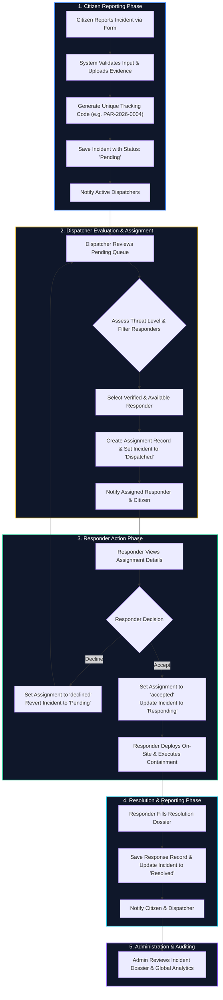
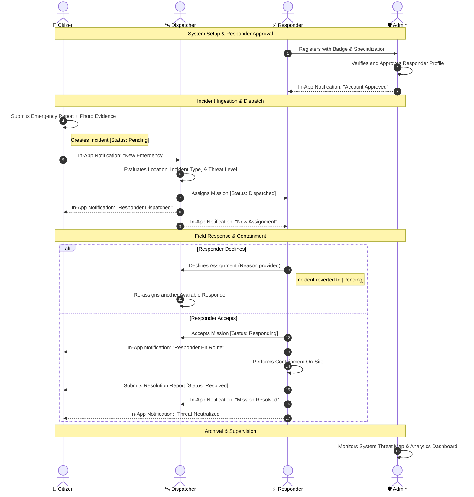
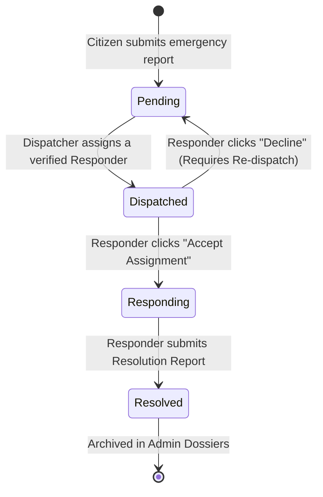
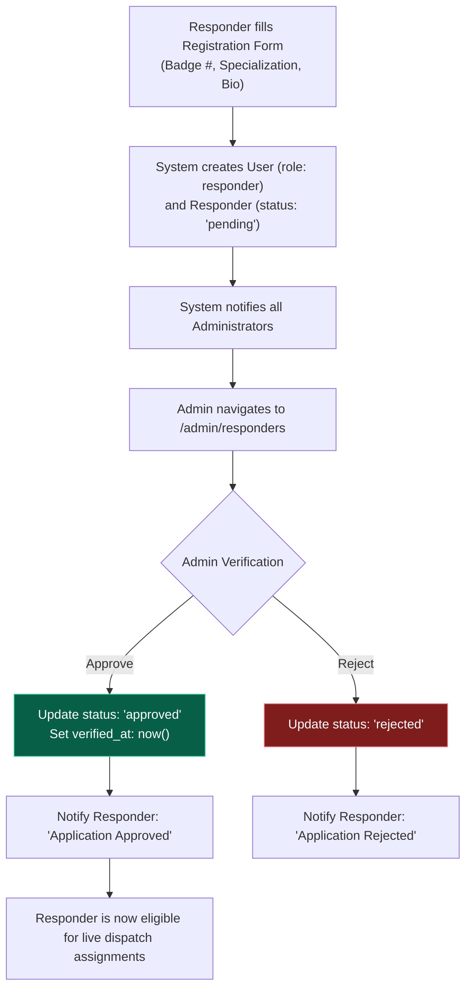

# SPECTRESCUE System Flowcharts & Architecture Guide

> **Project ALIEN 2026 — Paranormal Emergency Response & Dispatch Management System**  
> *Prepared for Project Defense & Technical Presentation*

---

## 1. End-to-End Emergency Lifecycle Flowchart

This flowchart illustrates how an emergency incident moves from initial citizen reporting all the way through dispatch, containment, and final administrative audit.

---

## 2. Multi-Role Swimlane Flowchart

This swimlane demonstrates exactly what each of the **four user roles** does, how they interact with each other, and where the system automated actions occur.

---

## 3. Incident State Machine (Status Transitions)

The table and state diagram below show every possible state for an incident, the triggering action, the acting role, and the database changes.

### State Transition Summary Table

| From State | To State | Triggering Action | Acting Role | Controller & Action |
| :--- | :--- | :--- | :--- | :--- |
| **None** | `Pending` | Submits report form with evidence | Citizen | `CitizenController@storeIncident` |
| `Pending` | `Pending` | Updates report details, address, or map coordinates | Citizen | `CitizenController@updateIncident` |
| `Pending` | `Dispatched` | Selects responder & confirms assignment | Dispatcher | `DispatcherController@assignResponder` |
| `Dispatched` | `Responding` | Clicks "Accept Assignment" | Responder | `ResponderController@respondAssignment` |
| `Dispatched` | `Pending` | Clicks "Decline Assignment" | Responder | `ResponderController@respondAssignment` |
| `Responding` | `Resolved` | Submits containment & findings report | Responder | `ResponderController@storeReport` |

---

## 4. Responder Verification Sub-Flowchart

To ensure safety and authenticity, Responders must undergo administrative verification before receiving any emergency assignments.

---

## 5. Defense Quick-Reference: Database Tables & Role Access

When presenting this flowchart to panel members or instructors, use this mapping to explain the system architecture:

| Table | Associated Model | Primary User Role | Purpose in Flowchart |
| :--- | :--- | :--- | :--- |
| `users` | [User](file:///j:/SystemFilesNew/wamp64/www/ProjectALIEN2026/app/Models/User.php) | All (`citizen`, `dispatcher`, `responder`, `admin`) | Central authentication & role access control. |
| `incident_types` | [IncidentType](file:///j:/SystemFilesNew/wamp64/www/ProjectALIEN2026/app/Models/IncidentType.php) | System / Admin | Classification (e.g. Poltergeist, Demonic Possession, Cryptid). |
| `responders` | [Responder](file:///j:/SystemFilesNew/wamp64/www/ProjectALIEN2026/app/Models/Responder.php) | Responder / Admin | Professional profile, badge number, specialization, availability. |
| `incidents` | [Incident](file:///j:/SystemFilesNew/wamp64/www/ProjectALIEN2026/app/Models/Incident.php) | Citizen / Dispatcher | Main emergency tracking entity (`Pending` -> `Dispatched` -> `Responding` -> `Resolved`). |
| `evidence` | [Evidence](file:///j:/SystemFilesNew/wamp64/www/ProjectALIEN2026/app/Models/Evidence.php) | Citizen | Photos or documents uploaded to support the incident report. |
| `assignments` | [Assignment](file:///j:/SystemFilesNew/wamp64/www/ProjectALIEN2026/app/Models/Assignment.php) | Dispatcher / Responder | Connects Incident, Dispatcher, and Responder (`assigned`, `accepted`, `declined`). |
| `responses` | [Response](file:///j:/SystemFilesNew/wamp64/www/ProjectALIEN2026/app/Models/Response.php) | Responder | Resolution report (containment method, findings summary, neutralized flag). |
| `notifications` | [Notification](file:///j:/SystemFilesNew/wamp64/www/ProjectALIEN2026/app/Models/Notification.php) | All Users | Real-time in-app alerts triggered at every step of the workflow. |
